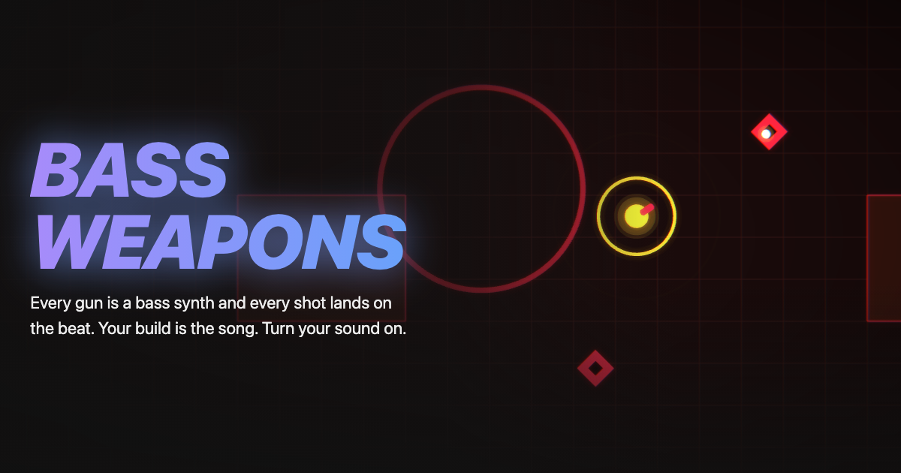

# Riddim Riot

**Every gun is a bass synth. Every shot lands on the beat. Your build is the
song.**

A top-down, twin-stick rhythm shooter that runs in the browser, on a desktop
or on a phone. Every weapon is a dubstep bass synth and every shot is
quantized to the beat, so the way you fight writes the track.

**[Play it at riddimriot.com](https://riddimriot.com)**



## The game

A run is five levels. Each level is an arena and a song, generated from a
seed: intro, breakdown, build-up, three drops with a bridge, and an outro.

- **Step into the circle** in the middle of the arena. It fills over a bar
  (step out and it drains), then the music slams in.
- **Survive the song.** Waves follow the arrangement. The last drop brings a
  boss, which always drops a good weapon.
- **Leave through the circle.** Once the outro plays it opens again. Stand
  in it to go to the next level, with a new arena, key and palette.

Health, score and weapons carry over between levels. Enemies drop hearts
that heal you, and five hits end the run. A finished run can post to the
arcade leaderboard, and **Copy seed link** lets you share or replay its
seed.

### Weapons are instruments

You start with one weapon per engine: a wobble, a laser and a beam. The
beam fires for as long as you hold it, up to a bar, and then overheats and
has to recharge; letting go cools it. Loot weapons are rolled from parts,
and each part sets a gameplay stat and a synth parameter together, so your
loadout is an instrument rack. Weapons with **Crush** burst on every hit,
damaging and pushing back everything nearby. Loot is pulled into your bag;
open the loadout menu to listen to it, swap it into a slot or throw it out.

### Controls

Press **Drop in** or Enter to start (browsers only start audio after a
press). **Reduce flashing** turns off the screen shake and flashes; it
follows your system's reduced-motion setting until you change it.

| Input                         | Action                                           |
| ----------------------------- | ------------------------------------------------ |
| WASD / arrow keys             | Move                                             |
| Mouse                         | Aim                                              |
| Left mouse (click or hold)    | Fire, quantized to the weapon's beat division    |
| 1 / 2 / 3, Q / E, mouse wheel | Switch weapon slot (or click a slot to fire)     |
| Space                         | Dash (through enemies and orbs; 2-beat cooldown) |
| Tab or B                      | Loadout menu: swap in loot from the bag (pauses) |
| Esc / P                       | Pause and resume (also the **Pause** button)     |

On a phone or tablet the game is landscape only. Android goes fullscreen
and locks the rotation; on other phones a notice asks you to turn them.

| Touch                                       | Action                                             |
| ------------------------------------------- | -------------------------------------------------- |
| Left half: a stick appears under your thumb | Inside the inner rim, turn; past it, move that way |
| Right half: tap or hold                     | Fire the weapon last fired (on touch, on the beat) |
| A weapon slot (right edge): tap or hold     | Switch to that weapon and fire it                  |
| **Dash** button (bottom right)              | Dash                                               |
| **Bag** button (top right)                  | Loadout menu: swap in loot from the bag            |

Switching tabs or turning the phone upright also pauses the game, and only
**Resume** starts it again. From the pause, **Loadout and bag** (or B)
opens the loadout menu, and closing it takes you back to the pause.

## Run it locally

You need Node 24 (`.nvmrc`) and pnpm (pinned in `package.json`).

```sh
pnpm install
pnpm dev            # http://localhost:3000
```

The game runs without any setup. The leaderboard needs a
[Neon](https://neon.tech) Postgres database: put its connection strings in
`.env.local`, then apply the migrations:

```sh
# .env.local
DATABASE_URL=postgres://…            # pooled
DATABASE_URL_UNPOOLED=postgres://…   # direct, used for migrations

pnpm db:migrate
```

The migrations create the schema, the row level security policies and the
limited `bass_app` role that every request runs as.

### URL options

| URL                  | What it does                                                                                                                                           |
| -------------------- | ------------------------------------------------------------------------------------------------------------------------------------------------------ |
| `/?seed=42`          | Play a specific level. A number or any word (`?seed=wobble`)                                                                                           |
| `/?stress`           | Skip the circle and fill the level to the 30-enemy cap from the first bar, for performance checks                                                      |
| `/?latency=playback` | Pick the audio buffer: `interactive`, `balanced` (desktop default) or `playback` (touch-screen default, as Firefox on phones crackles on smaller ones) |

### Play-testing from the console

Open the browser's dev console on the game page and call `riot.help()`.
`riot` rigs the next run, starting it on a later level and forcing a subgenre or tempo,
and lends a hand in the level under way:

```js
riot.level(4); // start on level 4, the loadout at tier 4
riot.subgenre('liquid'); // every level plays Liquid (riot.subgenre() to clear)
riot.bpm(174); // every level at 174 BPM
riot.god(); // take no hits (riot.god(false) to stop)
riot.stress(); // as ?stress
riot.skipCircle(); // no circle: the song plays from the first bar
riot.seed(1234); // the run's seed
riot.rig({ level: 5, god: true }); // several at once
riot.reset(); // back to a normal run
riot.skip(); // in a level: clear it now
riot.loot(5); // in a level: fill the bag with tier 5 loot
```

The rig is kept on the device until `riot.reset()`. The start screen
says what's rigged. Press Drop in to start: the console can't start
audio, only a press can. A rigged run never goes on the board, doesn't
count as the device's best, and doesn't keep its loadout for the next
run.

## Sound playground

Open <http://localhost:3000/playground> while `pnpm dev` runs, press
**Start audio**, and tune by ear. Every value that shapes the sound has a
control, and you hear it through the game's own voices, drums and
arrangement at 140 BPM.

1. **Listen.** Pick a key, switch the drums and the section (calm, groove,
   build, drop), and fire one-shots: impact, kill + score (each press is
   the next kill of a combo, so the pluck climbs), Crush blast, reload,
   beam recharge, riser and drop hit.
2. **Pick a weapon.** Roll seeds or step through them, and pin any part
   (engine, manufacturer, LFO rate, FX) to hear just that kind. **Hold** or
   **Mash** fires hands-free while you turn knobs. **Compare rolls** lines
   up eight seeds from the current design.
3. **Shape the sound.** The groups on the right are the engines and their
   layers (sub, reese stack, growl, click), the weapon mix and loudness
   target, the sidechain, the parts pool (the ranges rolls land in), drums,
   kill impact, blast, score, recharge, reload, arrangement and the pad bed.
   Changed values are marked and counted per group, and each group can be
   reset.
4. **Save to game.** This writes `src/game/sound/design.json`; reload the
   game to play with it. **Export** and **Import** move a design as a file,
   and drafts stay in the browser between reloads.

"This roll's sound" changes only the weapon you're listening to. To change
what every roll can sound like, change the parts pool ranges instead.

## How it's built

- **One clock.** Tone.js's Transport is the only time source. Sound,
  simulation and visuals all react to its ticks, so the visuals lock to the
  kick instead of approximating it. Drawing follows the clock you hear,
  which trails the audio clock by the output latency, so visuals stay in
  sync on Bluetooth headphones too.
- **A lean audio graph.** Voices are built from always-running sources with
  gated envelopes, one browser node per node, so a hit never creates new
  nodes and a phone can keep up.
- **Measured, not guessed.** Each weapon's loudness is measured by
  rendering a bar offline when it's armed.
- **React only renders screens.** The game loop runs outside React and
  publishes HUD updates only when they change.

[`docs/architecture.md`](docs/architecture.md) explains how the code fits
together, what was measured and what's next.
[`design-brief-poc.md`](design-brief-poc.md) is the original design brief,
and [`CLAUDE.md`](CLAUDE.md) lists the rules to keep when you change the
code.

### Stack

TypeScript, [Tone.js](https://tonejs.github.io/) (audio and the musical
clock), [PixiJS](https://pixijs.com/) (WebGL rendering and the fullscreen
shader), React with styled-components and `@pindakaasman/design-system`
(screens only, never the game loop), Next.js on Vercel, tRPC and Drizzle
on Neon Postgres (the leaderboard), Vitest and Storybook (both on Vite),
and Playwright. Coding conventions come from the
[mise](https://github.com/RamonGebben/mise) plugins listed in
[`CLAUDE.md`](CLAUDE.md).

### Scripts

| Script                         | Runs                                                        |
| ------------------------------ | ----------------------------------------------------------- |
| `pnpm dev`                     | Next.js dev server                                          |
| `pnpm build`                   | Production build (typechecks too)                           |
| `pnpm start`                   | Serve the production build                                  |
| `pnpm format` / `format:write` | Prettier check / fix                                        |
| `pnpm lint`                    | ESLint                                                      |
| `pnpm typecheck`               | `tsc --noEmit`                                              |
| `pnpm test`                    | Vitest unit tests (Node, no DOM)                            |
| `pnpm test:storybook`          | Storybook interaction tests in Chromium, Firefox and WebKit |
| `pnpm test:e2e`                | Playwright end-to-end tests in Chromium, Firefox and WebKit |
| `pnpm test:db`                 | Leaderboard policies and routers against the Neon database  |
| `pnpm db:migrate`              | Apply `db/migrations` to the database in `.env.local`       |
| `pnpm storybook`               | Storybook on port 6006                                      |

A husky + lint-staged pre-commit hook runs Prettier, ESLint, typecheck and
the unit tests on every commit. Changes to audio start-up or input should
pass `test:e2e` and `test:storybook` in all three engines.

## License

[MIT](LICENSE) © Ramon Gebben
